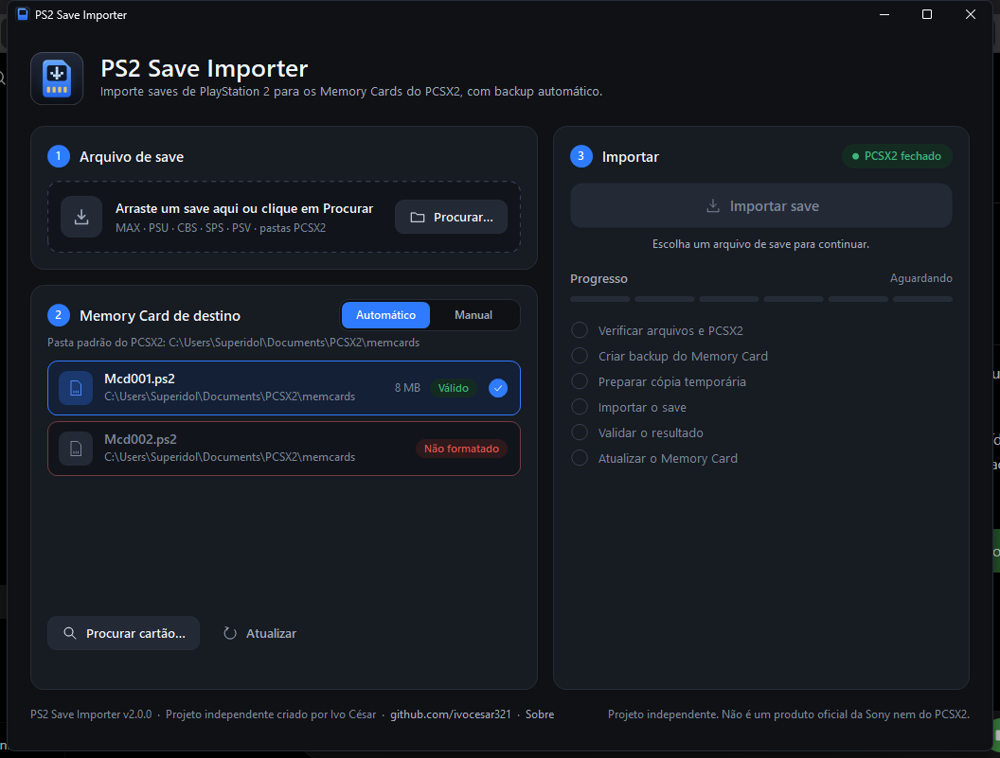

# PS2 Save Importer

Aplicativo para Windows que importa saves de **PlayStation 2** (MAX, PSU, CBS, SPS, PSV e pastas de save do PCSX2) para os **Memory Cards do PCSX2**, sempre com backup automático e sem tocar no cartão original até que o save tenha sido importado e validado.

> **Projeto independente criado por [Ivo César](https://github.com/ivocesar321).**
> Não é um produto oficial da Sony Interactive Entertainment nem do projeto PCSX2, e não tem vínculo com nenhum dos dois.
> "PlayStation" e "PS2" são marcas de seus respectivos proprietários; aqui são usadas apenas para descrever a compatibilidade.



## Recursos

- **Interface moderna em tema escuro** (inspirada no Fluent Design / Windows 11): cantos arredondados, ícones vetoriais, animações discretas e layout responsivo (duas colunas em janelas largas, uma coluna em janelas estreitas, rolagem quando necessário).
- **Seleção do save** por botão ou arrastando arquivo/pasta para a janela. Para saves extraídos do PCSX2, selecione a pasta do jogo que contém `icon.sys`, `game.icn` e o arquivo de dados (ex.: `BASLUS-21087`).
- **Memory Card de destino, do seu jeito**
  - *Automático*: detecta os cartões `.ps2` da pasta padrão do PCSX2 (`Documentos\PCSX2\memcards`).
  - *Manual*: botão **Procurar cartão…** abre o seletor de arquivos do Windows para escolher qualquer `.ps2` (também dá para arrastar o arquivo para a janela). O cartão entra na lista de destinos, **sem duplicar** (mesmo que o caminho seja escrito de outra forma) e **só se for um Memory Card válido**. Os cartões manuais ficam salvos para a próxima vez.
- **Importação com acompanhamento**: confirmação antes de começar, confirmação específica antes de substituir um save existente, etapas com status em tempo real e resultado com o **caminho do backup criado** (atalhos para abrir a pasta e copiar o caminho).
- **Sem porcentagens inventadas**: o `mymc.exe` não informa progresso. A barra é dividida em etapas (concluídas / em andamento) e o brilho animado indica atividade; nenhuma porcentagem é exibida.
- **Mensagens claras de sucesso e de erro**, com os detalhes técnicos disponíveis em "Ver detalhes".

## Como usar

1. Feche o PCSX2.
2. Escolha o arquivo de save ou a pasta do jogo extraída do PCSX2 (**Procurar…** ou arraste para a janela).
3. Escolha o Memory Card (automático ou **Procurar cartão…**).
4. Clique em **Importar save** e confirme.
5. Ao terminar, abra o jogo no PCSX2.

Atalhos: `Ctrl+O` escolhe o save · `F5` atualiza a lista de cartões detectados.

## Como seus Memory Cards são protegidos

1. O PCSX2 precisa estar fechado (o programa verifica antes e de novo imediatamente antes de gravar).
2. É criado um **backup** ao lado do cartão: `NomeDoCartao.ps2.backup-AAAAMMDD-HHMMSS`.
3. O save é importado em uma **cópia temporária** do cartão.
4. Se já existir um save com o mesmo nome, você escolhe se quer substituí-lo (apenas esse save é trocado).
5. O resultado é **validado** na cópia. Só então o cartão original é atualizado.
6. Qualquer falha preserva o cartão original e mostra onde está o backup.

### Sobre cartões "Não formatado"

Quando o PCSX2 cria um Memory Card novo, o arquivo `.ps2` fica vazio (preenchido com `0xFF`) até ser formatado. O programa mostra esses cartões como **Não formatado** e não permite escolhê-los, porque o motor de importação não consegue gravar neles. Formate o cartão no PCSX2 (ou use-o uma vez em um jogo) e clique em **Atualizar**.

## Formatos de save suportados

| Extensão | Formato |
|---|---|
| `.max` | Action Replay MAX |
| `.psu` | PSU (EMS) |
| `.cbs` | CodeBreaker |
| `.sps` | SharkPort |
| `.psv` | PSV (save de PS2 exportado pelo PlayStation 3) |
| Pasta | Estrutura de save do PCSX2 (`icon.sys`, `game.icn` e arquivos do jogo) |

## Requisitos

- Windows 10 ou Windows 11 (64 bits).
- A versão publicada (`dist`) é autossuficiente: **não exige instalar o .NET**.
- Para compilar: SDK do .NET 8 ou mais novo.

## Compilar

```powershell
.\build.ps1              # compila em Release  -> App\bin\Release\net8.0-windows
.\build.ps1 -Publish     # gera a pasta dist\ (um executável único com MyMC embutido)
.\build.ps1 -Test        # compila e roda os testes automatizados
```

Ou diretamente: `dotnet build App\Ps2SaveImporter.csproj -c Release`.

O `mymc.exe` (motor de importação) é **embutido dentro do PS2SaveImporter.exe**. Na primeira execução, é extraído automaticamente para `%LOCALAPPDATA%\PS2SaveImporter\tools`; não precisa acompanhar o executável no pendrive.

## Estrutura do projeto

```
App/
  Core/      lógica sem interface: importação/backup, validação de cartões, lista de destinos, formatos, preferências
  UI/        controles desenhados à mão (botões, lista de cartões, progresso, diálogos), tema e ícones vetoriais
  Views/     janela principal e cartões de seção
  Assets/    AppIcon.ico (+ pré-visualização)
  mymc.exe   motor de importação (embutido como recurso no executável)
tools/
  IconGenerator/  gera o AppIcon.ico a partir da marca vetorial
  SelfTest/       testes automatizados (lógica + capturas de tela da interface)
docs/             capturas de tela
build.ps1         script de compilação
```

## Ícone

O ícone é original: um Memory Card (canto chanfrado e contatos dourados) com uma seta de importação em pixel art, sobre um bloco grafite. O arquivo `App/Assets/AppIcon.ico` contém os tamanhos 16, 20, 24, 32, 40, 48, 64, 128 e 256 px, com versões simplificadas para os tamanhos pequenos. Para regenerar:

```powershell
cd tools\IconGenerator
dotnet run -c Release -- ..\..\App\Assets\AppIcon.ico ..\..\App\Assets\AppIcon-preview.png
```

## Testes

`tools/SelfTest` usa **cópias e cartões sintéticos** (nunca os seus cartões reais) para verificar: validação de cartões (incluindo não formatado, truncado, somente leitura e bloqueado), lista de destinos sem duplicados, importação `.psu` e `.max`, backup idêntico ao original, cancelamento/substituição de saves existentes, falhas que preservam o cartão, proteção com o PCSX2 aberto e preferências. A rotina de importação de pastas também foi exercitada separadamente com um cartão descartável.

## Créditos e autoria

- **PS2 Save Importer** — projeto independente criado por **Ivo César** · <https://github.com/ivocesar321>
- A importação de saves usa o **mymc** (`mymc.exe`), construído a partir do repositório incluído em `source/ps2-memory-card-manager-main` (consulte a licença nessa pasta). É um componente de terceiros.
- PCSX2 é um projeto independente; este programa apenas trabalha com os arquivos de Memory Card que ele usa.
